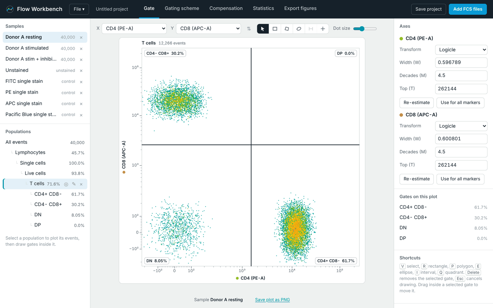
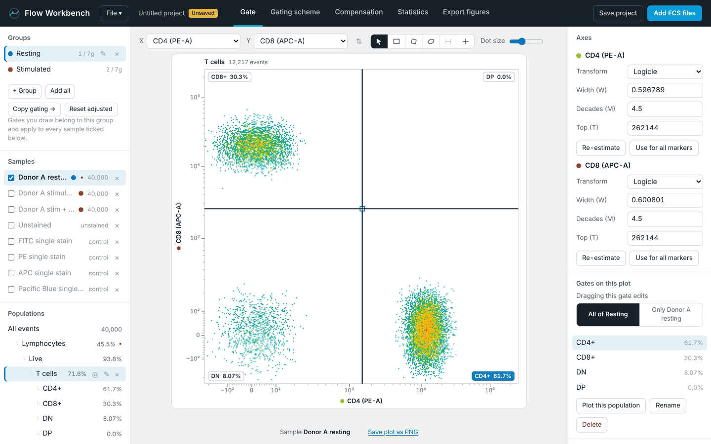
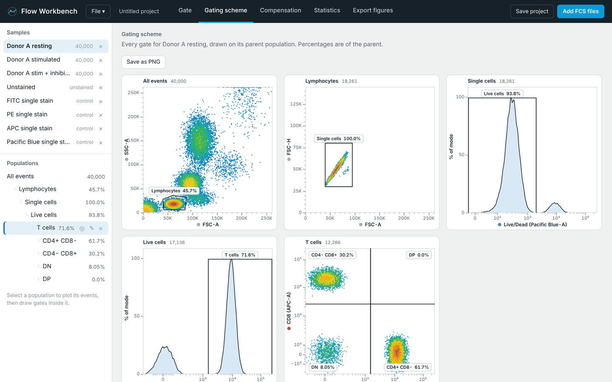
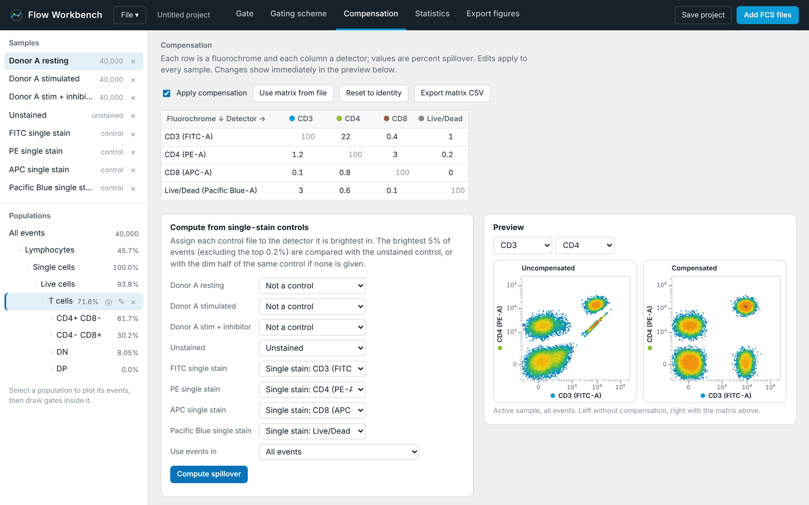
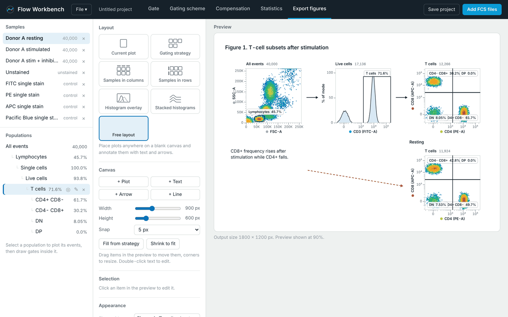

# Flow Workbench

**Browser-based flow cytometry analysis — gating, compensation, statistics and publication figures, in a single HTML file.**

[](LICENSE)
[](#getting-started)
[](#privacy)

Flow Workbench covers the everyday flow cytometry workflow — compensation, transformation, interactive gating, population statistics and figure export — with no R, no Bioconductor, no XQuartz and no compiler. Everything lives in one `flow_workbench.html` file that opens in any modern browser.

**[→ Open the live app](https://linjianglao.github.io/flow-workbench/)**  ·  **[Download the file](https://github.com/linjianglao/flow-workbench/releases/latest)**  ·  **[Development log](docs/DEVELOPMENT_LOG.md)**



## Why this exists

FlowJo academic seats run roughly $220–350 per person per year through institutional site licences, which is a real barrier for trainees, visitors and small labs, and for anyone who needs to look at data away from a licensed machine. Flow Workbench is a free, zero-install alternative for the common case: gate a hierarchy, compensate it, get the numbers out, and build a figure you can drop into a paper.

It is not a FlowJo replacement. It has no spectral unmixing, no clustering or dimensionality reduction, no plugin ecosystem and no workspace import. What it does have is the full manual-gating path, and a figure composer that is genuinely better than exporting plots one at a time and assembling them in Illustrator.

## Privacy

Your FCS files are parsed by JavaScript in your own browser. Nothing is uploaded, there is no server, no account and no telemetry, and the app works with your network cable unplugged. That makes it safe for unpublished data and for data you are not permitted to put in a cloud service.

## Getting started

**Use it online:** open <https://linjianglao.github.io/flow-workbench/> — nothing is installed, and your files still never leave your computer.

**Use it offline:** download `flow_workbench.html` from the [latest release](https://github.com/linjianglao/flow-workbench/releases/latest) (or from `dist/` in this repository) and double-click it. It opens in your default browser and works with no network connection. To share it with a colleague, send them the file.

Either way, click **Try with demo data** to explore, or **Add FCS files** to load your own.

Chrome, Edge, Safari and Firefox all work. Chrome and Edge additionally let you save a project straight back to the same file rather than downloading a new copy each time.

## Groups



A **group** is a set of samples that share one gating tree. Every session starts with a single group holding every file you load, so if you never touch the panel the tool behaves exactly as before.

Create more groups when one session holds files that need different treatment — two panels, two experiments, two days of acquisition. Each group owns its gating tree, so gates you draw belong to the active group and apply to every sample ticked into it. Adding a file to a group gates it instantly.

- **A sample can sit in several groups**, which is useful when the same file is both a donor and a condition. Because two groups can gate the same file differently, a population is identified by the pair (group, gate), and the active group decides what the Gate tab shows and what Statistics reports.
- **Copy gating →** duplicates one group's whole tree into another. The copy gets fresh gate ids, so editing one tree never moves the other.
- **Per-sample adjustment.** Real populations shift between files. Select a gate and the inspector offers a switch: dragging edits *all of the group*, or *only this sample*. A sample-scoped drag stores an override for that file alone, leaves the group's own shape untouched, and marks the gate with a dot wherever it appears. **Reset to group shape** discards one override; **Reset adjusted** in the Groups panel discards every override in the group.
- **Statistics are reported per group**, with an optional `mean ± SD (n=…)` summary row for each population. A sample in two groups appears under both, measured against each group's gates.

## The workflow

The five tabs run left to right in the order you would normally work.

### Gate

Pick channels for the X and Y axes, or set Y to **Histogram** for a one-dimensional plot. The tools in the toolbar draw gates:

| Tool | Key | Notes |
|---|---|---|
| Select | `V` | Click a gate to select it, drag a handle to reshape, drag the middle to move |
| Rectangle | `R` | Drag one corner to the other |
| Polygon | `P` | Click each vertex, then double-click or press `Enter` to close |
| Ellipse | `E` | Drag outward from the centre |
| Interval | `I` | Histograms only |
| Quadrant | `Q` | One click creates all four populations |

Press `Delete` to remove the selected gate, `Esc` to cancel a drawing in progress.

Every gate is drawn inside whichever population is selected in the sidebar, which is how the gating hierarchy is built. Select a child population in the tree to gate deeper. A gate you drag or reshape recalculates immediately, along with everything downstream of it.

The inspector on the right sets the transform per channel — linear, log, arcsinh or logicle. Logicle width is estimated from the negative population in your data, and **Use for all markers** copies one channel's settings to every fluorescence channel. On histograms you can overlay other samples to compare them directly.

### Gating scheme



Shows every gating step for the active sample on one page, each plot drawn on its parent population with the frequency of parent. Useful for checking a strategy at a glance or saving a quick PNG.

### Compensation



The spillover matrix is read from the FCS file when one is stored there. Each row is a fluorochrome and each column a detector, in percent. You can:

- Edit any value by hand and watch the before/after preview update live.
- **Compute from single-stain controls**: assign each control file to the detector it is brightest in, mark your unstained sample, and press Compute. The brightest 5% of events (excluding the top 0.2%) are compared against the unstained control, or against the dim half of the same control if you have no unstained sample. You can restrict this to a gated population, which is usually better than using all events.
- Restore the matrix from the file, reset to identity, or export the matrix as CSV.

Compensation applies to every sample at once and feeds through to all gates and statistics.

### Statistics

Counts, % of parent and % of all events for every population in every sample, blocked by group. Per-marker statistics are available as median, mean, geometric mean or robust CV, calculated on compensated but untransformed values. Tick **Group mean ± SD** for a summary row per population, filter to one group, choose which channels appear, then export the whole table as CSV — including the group, the summary flag, n, and an SD column beside every value.

The same tab exports the events of any population as a new FCS file, with compensated values if compensation is on.

### Export figures



Six layouts, each with a live preview:

- **Current plot** — the plot from the Gate tab, including histogram overlays and a legend.
- **Gating strategy** — every gating step for one sample in a grid, with adjustable column count.
- **Samples in columns** — one column per sample, one row per plot, for comparing conditions.
- **Samples in rows** — one row per sample, gating steps running across the page.
- **Histogram overlay** — one marker on shared axes, comparing either several samples in one population or several populations within one sample.
- **Stacked histograms** — the same comparison as a ridgeline, with gate frequencies or event counts down the right edge.
- **Free layout** — a blank canvas you compose by hand (see below).

You choose which plots and samples to include and can set a figure title, panel size, text size, dot size, whether gate names and percentages appear, and whether the background is transparent.

#### Free layout

For figures the fixed grids can't express, choose **Free layout** and build the page yourself.

- **+ Plot** adds a panel. Each panel has its own sample, population, X and Y channels, title and dot size, so you can put two conditions side by side or repeat one population across markers.
  - To show **several samples, or several populations, inside one panel**, select the panel and tick them under *Also show in this panel*. Histograms become coloured curves; dot plots become colour-coded, alpha-blended events. Tick samples under *Also show: other samples*, populations under *Also show: other populations*, or both at once for a sample-by-population grid. A legend names each series: comparing samples on a single-gate panel it prints each sample's frequency for that gate, and comparing populations it prints event counts. The legend corner is selectable so it never sits on a gate label.

  Comparing populations is the right tool for questions like "is CD25 higher on CD4+ than CD8+ in this donor". Each histogram is normalised to its own mode, so a population of 987 events and one of 7,570 are still comparable in shape.
- **+ Text** adds a caption or a label. Double-click text in the preview to edit it; press Enter inside the box for multiple lines.
- **+ Arrow** and **+ Line** add annotations, with arrowheads at one end, both ends or neither, plus thickness, dashes and colour.

Drag items in the preview to move them and drag a panel's corners to resize it (hold Shift to keep it square). Arrow keys nudge the selection by one pixel, Shift with an arrow key moves it by ten, and Delete removes it. Items can be duplicated or reordered front to back. A snap setting keeps edges aligned, and can be switched off.

Two shortcuts help you start: **Fill from strategy** lays out every gating step of the chosen sample, ready for you to rearrange, and **Shrink to fit** trims the canvas to the content once you're done.

Free layouts are saved inside the project file, so a figure can be reopened and adjusted after review.

Three output formats:

- **PNG** at 1×, 2× (about 150 dpi) or 4× (about 300 dpi).
- **SVG** — axis labels, gate names and percentages stay as editable text and gates stay as paths, so figures can be relabelled in Illustrator, Inkscape or Affinity Designer. Only the dot-plot density layer is an embedded bitmap; histograms are fully vector.
- **PDF** — opens your browser's print dialog, where you choose "Save as PDF". Allow pop-ups for the file if nothing appears.

## Saving your work

There are two kinds of save, and they serve different purposes.

**Project files (`.fwproj`)** contain your data *and* your analysis: the original FCS files, gates, transforms, compensation, sample names, control assignments and the view you were last looking at. Use **File > Save project** to keep your work and **File > Open project** to pick it up later. One project file is enough to reproduce or hand over an entire analysis. The header shows an *Unsaved* badge as soon as anything changes, and the browser warns you before closing with unsaved work.

Project files are compressed; the eight-sample demo comes to about 6 MB. The original file bytes are stored untouched, so acquisition date, cytometer name and the original spillover keyword all survive a round trip.

Project files also carry your groups, their membership and every per-sample adjustment, so reopening one puts you back exactly where you were.

**Gating templates (`.json`)** contain the analysis but *not* the data — gates, transforms and compensation only. Use these to apply a settled gating strategy to a new batch of files: load the new FCS files, then **File > Open gating template**. The template is rejected if the new files lack a channel it needs.

You can also drag a `.fwproj` or `.json` file straight onto the window.

## File format support

Reads FCS 2.0, 3.0 and 3.1 in list mode, with integer, float and double data types, including older log-amplified files (`$PnE`), which are converted to linear scale on read. Parameter names come from `$PnN` and marker names from `$PnS`.

The reader was checked against the Python `flowio` library on nine files from different instruments and formats; raw values match exactly.

All files loaded in one session must share the same channel names, even across groups. A file that doesn't match is skipped with a message naming the missing channels.

## Limitations

- This is an independent implementation modelled on CytoExploreR's workflow, not a port of its code. Numbers may differ slightly from CytoExploreR or FlowJo, so cross-check key results before publishing.
- No dimensionality reduction (tSNE, UMAP), no automated gating (openCyto), and no FlowJo or FCS workspace import.
- Very large files (several million events each) are limited by browser memory.
- Compensation from controls assumes one dominant fluorochrome per control file.

## Troubleshooting

**A file was skipped on loading.** It has different channel names from the files already loaded. Start a new project for that panel, or load it on its own.

**Save project does nothing.** If the save dialog was dismissed, nothing is written. Try again and choose a location. In browsers without the save-file API the project arrives as an ordinary download instead.

**The print window didn't open for PDF export.** Your browser blocked the pop-up. Allow pop-ups for this file, or export SVG and convert it.

**Gates look wrong after changing a transform.** Gates are stored in raw data units, not screen units, so they follow the data. If a gate ends up off-screen, widen the axis range in the inspector.

**Compensated values go strongly negative.** That is expected for genuinely negative populations on a logicle scale. If a whole population is pushed negative, the spillover value for that pair is probably too high.

## Repository layout

```
src/            source files, inlined at build time
  shell.html      markup and CSS
  core.js         FCS I/O, transforms, compensation, gates, statistics (DOM-free)
  ui.js           rendering, interaction, sidebar, the four analysis tabs
  svgctx.js       Canvas-2D-compatible SVG recorder for vector export
  project.js      .fwproj save/open, dirty tracking, File menu
  export.js       figure layouts, preview, PNG/SVG/PDF output
  free.js         free-form canvas: item model, editing, annotations
build.py        inlines src/ into dist/flow_workbench.html and docs/index.html
dist/           the built single-file app
docs/           GitHub Pages site, screenshots, development log
tests/          Node unit tests and a Playwright end-to-end script
```

## Building from source

```bash
git clone https://github.com/linjianglao/flow-workbench.git
cd flow-workbench
python3 build.py          # writes dist/flow_workbench.html and docs/index.html
```

No bundler, minifier or transpiler, and no dependencies. The shipped file *is* the source — readable with View Source. Python 3 is used only to concatenate files.

### Tests

```bash
node tests/core.test.js                 # transforms, compensation, gates, FCS round-trip
python3 tests/e2e.py                    # Playwright UI walkthrough (needs: pip install playwright)
```

`tests/core.test.js` runs `src/core.js` directly under Node, since that file is deliberately DOM-free.

## Contributing

Issues and pull requests are welcome — see [CONTRIBUTING.md](CONTRIBUTING.md). If you hit an FCS file this tool misreads, that is the most useful bug report you can file: the parser has been checked against nine files from different instruments, but the FCS standard is interpreted liberally in the wild.

## Citing

If this tool contributed to published work, please cite it using the metadata in [CITATION.cff](CITATION.cff). GitHub renders a "Cite this repository" button from that file.

## Validation status

This is an independent implementation, not a validated equivalent of any commercial package. The FCS reader has been checked event-for-event against the `flowio` Python library on nine files spanning FCS 2.0/3.0/3.1, integer and float data types, both byte orders and log-amplified channels; the compensation solver recovers a known spillover matrix from synthetic controls to within 0.0005; and the logicle transform round-trips to a relative error of 1.5 × 10⁻⁷. See the [development log](docs/DEVELOPMENT_LOG.md) for details.

**Cross-check key numbers against your usual software before publishing them.** This software is for research use only. It is not a medical device and must not be used for diagnostic or clinical decisions.

## License

MIT — see [LICENSE](LICENSE). No third-party code is bundled, so there are no inherited licence obligations. CytoExploreR, which inspired the workflow, is GPL-3 licensed; nothing here derives from its code.

## Technical notes

The logicle transform follows Parks, Roederer and Moore (2006), with the width parameter estimated from the fifth percentile of negative events. Compensation inverts the spillover matrix by Gauss-Jordan elimination with partial pivoting and applies it as `raw %*% solve(S)`, matching flowCore's convention. Density colouring uses a log-scaled count per bin. Events beyond the axis range are clamped onto the axis so that what you see is what you gate.
